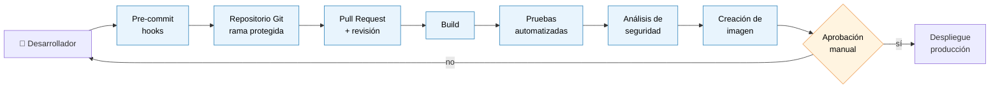

# Pipeline DevSecOps — ReMarket

> **Responsable:** _por asignar_ · **Estado:** ⬜ Sin empezar

## 1. Flujo del pipeline

Esqueleto de partida — revisar, corregir y justificar. Vista previa: https://mermaid.live

## 2. Dónde va cada control y por qué

**Ésta es la tabla que se evalúa.** La columna *Por qué aquí* es la que puntúa.

| Control | Etapa | Herramienta / mecanismo | Por qué en esa etapa | ¿Bloquea? |
| --- | --- | --- | --- | --- |
| Revisión de código | | | | |
| Análisis estático (SAST) | | | | |
| Análisis de dependencias (SCA) | | | | |
| Detección de secretos | | | | |
| Análisis de imágenes de contenedores | | | | |
| Pruebas automatizadas | | | | |
| Control de acceso | | | | |
| Manejo seguro de secretos | | | | |
| Aprobación antes de producción | | | | |

> *¿Bloquea?* = si el control falla, ¿se detiene el pipeline o solo avisa? Decidirlo y
> justificarlo: bloquearlo todo paraliza al equipo, no bloquear nada vuelve el control
> decorativo.

## 3. Manejo de secretos en el pipeline

- ¿De dónde saca el pipeline sus credenciales?
- ¿Cómo se evita que un secreto acabe en los *logs* del build?
- ¿Qué pasa si un secreto se filtra — procedimiento de rotación?

_Desarrollar._

## 4. Control de acceso

- ¿Quién puede aprobar un despliegue a producción?
- ¿Quién puede modificar el propio pipeline? (un pipeline que se puede editar sin revisión
  es una puerta trasera)
- Ramas protegidas, firma de commits, principio de mínimo privilegio en el *runner*.

_Desarrollar._

## 5. Relación con la matriz de riesgos

| Control del pipeline | Riesgo que mitiga (ver entregable 3) |
| --- | --- |
| | |
