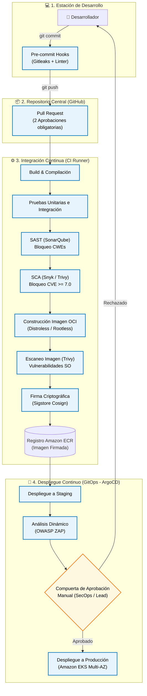

# Pipeline DevSecOps — ReMarket

> **Responsable:** Violeta / Equipo · **Estado:** ✅ Listo

## 1. Flujo del Pipeline CI/CD

El pipeline de ReMarket implementa **Shift-Left Security**, detectando vulnerabilidades de forma temprana y garantizando que solo código auditado y contenedores firmados criptográficamente se desplieguen en Amazon EKS.

---

## 2. Dónde va cada Control y por qué

| Control | Etapa | Herramienta / Mecanismo | Por qué en esa etapa | ¿Bloquea? | Justificación de Bloqueo |
| :--- | :--- | :--- | :--- | :---: | :--- |
| **Detección de Secretos** | Pre-commit y CI | Gitleaks / TruffleHog | En la máquina del programador antes de que el secreto entre al historial de Git. | **SÍ** | Un secreto commiteado queda en el historial inmutable; bloquear en el origen evita revocaciones complejas. |
| **Revisión de Código** | Pull Request | GitHub Branch Protection | Antes de integrar código en la rama principal (`main`). | **SÍ** | Exige al menos dos aprobaciones humanas cruzadas para garantizar coherencia arquitectónica. |
| **Análisis Estático (SAST)**| Integración (CI) | SonarQube / Semgrep | Inmediatamente tras compilar el código fuente. | **SÍ** | Detiene el flujo si hay vulnerabilidades críticas (inyección SQL, XSS, mal uso de criptografía). |
| **Análisis Dependencias (SCA)**| Integración (CI) | Snyk / Trivy SCA | Al resolver el árbol de paquetes (npm, pip, maven). | **SÍ** | Bloquea dependencias de terceros con vulnerabilidades conocidas $\text{CVSS} \ge 7.0$ con fix disponible. |
| **Escaneo de Contenedores** | Empaquetado | Trivy Container Scan | Sobre el archivo de imagen OCI antes de publicarlo al registro. | **SÍ** | Previene desplegar contenedores con paquetes de SO base obsoletos o con exploits conocidos. |
| **Firma Criptográfica** | Empaquetado | Sigstore Cosign | Al registrar la imagen validada en Amazon ECR. | **SÍ** | El clúster EKS cuenta con un controlador de admisión que rechaza imágenes no firmadas. |
| **Pruebas Automatizadas** | CI y Staging | JUnit, PyTest, Supertest | Durante el build y tras el despliegue preliminar. | **SÍ** | Asegura que los cambios de seguridad no rompan la funcionalidad ni la lógica de negocio. |
| **Análisis Dinámico (DAST)**| Staging | OWASP ZAP | En entorno de pre-producción con la aplicación en ejecución. | **NO (Alerta)**| Genera hallazgos de runtime sin frenar despliegues salvo detección de vulnerabilidades críticas confirmadas. |
| **Manejo Seguro Secretos** | Todo el flujo | AWS IAM OIDC + Secrets Manager | En cada paso que requiera privilegios o credenciales. | **SÍ** | Si la federación OIDC o la obtención del secreto falla, el pipeline se detiene por seguridad. |
| **Aprobación a Producción** | Despliegue | ArgoCD GitOps Gate | Justo antes de sincronizar el clúster productivo. | **SÍ** | Control de cambios humano formal exigido por normativas de auditoría y cumplimiento. |

---

## 3. Manejo de Secretos en el Pipeline

### ¿De dónde saca el pipeline sus credenciales?
- **Cero Claves Estáticas de AWS:** El runner de CI/CD (GitHub Actions / GitLab Runner) **no almacena `AWS_ACCESS_KEY_ID` ni `AWS_SECRET_ACCESS_KEY`**.
- **Federación OpenID Connect (OIDC):** El runner intercambia un token criptográfico OIDC emitido por GitHub con **AWS STS (Security Token Service)** para asumir un rol de IAM temporal (*AssumeRoleWithWebIdentity*). El rol otorga credenciales efímeras con validez de **15 minutos**, restringidas estrictamente a descargar dependencias y subir imágenes a Amazon ECR.

### ¿Cómo se evita que un secreto termine en los logs del build?
1. **Enmascaramiento en Consola:** Toda variable sensible se registra como *Secret Masked* en el motor de CI, siendo sustituida automáticamente por `***` en la salida estándar.
2. **Inyección en Runtime (External Secrets Operator):** Los pods en Kubernetes no reciben secretos como variables de entorno estáticas en el Dockerfile. En tiempo de ejecución, el operador **External Secrets** consulta **AWS Secrets Manager** vía IAM IRSA y mapea los valores a volúmenes `tmpfs` en memoria RAM, impidiendo que queden asentados en disco o en los logs de despliegue.

### Procedimiento ante Filtración de un Secreto
1. **Revocación Inmediata:** Desactivación de la clave comprometida en Secrets Manager / KMS en menos de 60 segundos.
2. **Rotación Automatizada:** Generación de un nuevo secreto mediante función AWS Lambda y actualización del almacén central.
3. **Rolling Restart:** Reinicio progresivo de los pods afectados en EKS para cargar el nuevo secreto desde memoria sin caída de servicio.
4. **Análisis Forense:** Auditoría de eventos en **AWS CloudTrail** para identificar todas las acciones ejecutadas con la clave comprometida durante la ventana de exposición.

---

## 4. Control de Acceso y Gobernanza

1. **Aprobadores de Despliegue a Producción:**
   - La aprobación requiere la firma digital de dos roles diferenciados: el **Líder de Desarrollo** y el **Oficial de Seguridad (SecOps)**, ambos con autenticación multifactorial (MFA FIDO2) obligatoria en la consola de GitOps (ArgoCD).
2. **Protección del Pipeline Contra Modificaciones No Autorizadas:**
   - Los archivos de configuración del pipeline (`.github/workflows/*` o `.gitlab-ci.yml`) están protegidos mediante directivas **CODEOWNERS**.
   - Cualquier modificación a las reglas del pipeline exige revisión y aprobación exclusiva del equipo de Arquitectura de Seguridad. Ningún desarrollador puede relajar las puertas de calidad de su propio código.
3. **Firma Obligatoria de Commits:**
   - Todos los commits deben estar firmados criptográficamente mediante **GPG o claves SSH** asociadas a la identidad corporativa verificada del desarrollador. Commits no firmados son rechazados en el hook de pre-receive del repositorio central.

---

## 5. Relación con la Matriz de Riesgos

| Control del Pipeline | Riesgo que Mitiga (Entregable 3) |
| :--- | :--- |
| **Pre-commit Gitleaks y roles temporales OIDC** | **R1:** Fuga de credenciales y API keys en repositorios Git. |
| **Análisis SCA (Snyk/Trivy) bloqueante en CI** | **R5:** Inyección de librerías de terceros con vulnerabilidades conocidas. |
| **Firma criptográfica de imágenes con Cosign** | **R5:** Despliegue de imágenes adulteradas o no autorizadas en el clúster. |
| **Imágenes Distroless y ejecución rootless** | **R2:** Movimiento lateral y compromiso cruzado tras vulnerar un pod. |
| **Inyección en memoria RAM vía External Secrets** | **R3:** Exfiltración de secretos en discos o respaldos persistentes. |
| **Doble aprobación humana y CODEOWNERS** | **R1 y R5:** Modificaciones maliciosas en el código o puertas traseras en el pipeline. |
